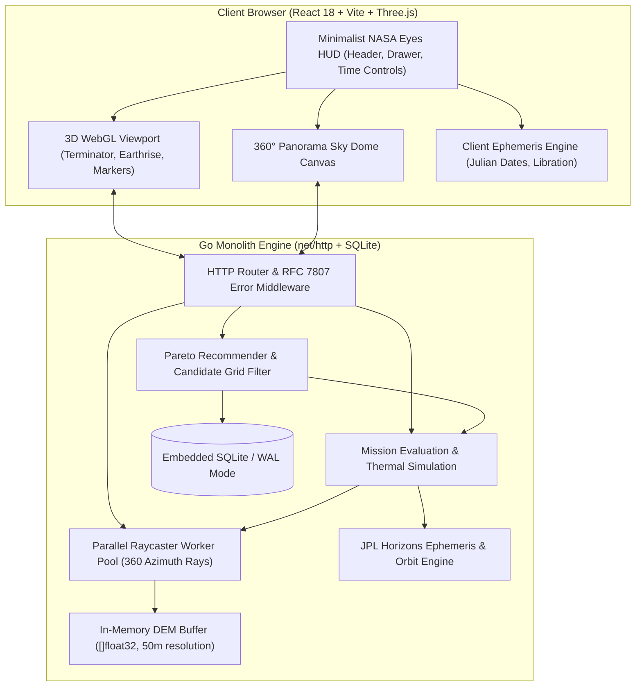

# Lunar Landing Site Navigator

<div align="center">

[](https://www.spaceappschallenge.org/)
[](https://golang.org)
[](https://react.dev/)
[](https://threejs.org/)
[](https://opensource.org/licenses/MIT)

**An interactive 3D astrodynamic and geospatial decision-support platform for evaluating, comparing, and ranking candidate landing sites at the Lunar South Pole for the Artemis and CLPS missions.**

*Developed by the **Gemini Team** for the **NASA International Space Apps Challenge 2026**.*

</div>

---

## 📑 Table of Contents

- [1. Executive Summary](#1-executive-summary)
- [2. The Challenge \& Problem Statement](#2-the-challenge--problem-statement)
- [3. Key Highlights \& System Features](#3-key-highlights--system-features)
- [4. Mathematical \& Astrodynamic Foundations](#4-mathematical--astrodynamic-foundations)
- [5. System Architecture](#5-system-architecture)
- [6. Verified NASA Datasets](#6-verified-nasa-datasets)
- [7. REST API Reference](#7-rest-api-reference)
- [8. Quick Start Guide](#8-quick-start-guide)
- [9. Testing \& Quality Assurance](#9-testing--quality-assurance)
- [10. Project Structure](#10-project-structure)
- [11. Judging Criteria Alignment](#11-judging-criteria-alignment)
- [12. License \& Acknowledgments](#12-license--acknowledgments)

---

## 1. Executive Summary

As humanity prepares for sustained lunar exploration through NASA's **Artemis Program** and the **Commercial Lunar Payload Services (CLPS)** initiative, landing site selection shifts from the equatorial plains of the Apollo era to the **Lunar South Pole** (latitudes $-75^\circ$ to $-90^\circ$). The South Pole is of paramount strategic value because its **Permanently Shadowed Regions (PSRs)**—such as Shackleton, Faustini, and Shoemaker craters—harbor billions of tons of water ice essential for In-Situ Resource Utilization (ISRU), rocket propellant, and life support.

However, operating near the lunar poles presents extreme hazards: grazing sunlight casting kilometers-long dynamic shadows, low Earth elevation angles risking communication blackouts, and frequent launch date delays that radically alter illumination geometry.

**Lunar Landing Site Navigator** bridges high-precision astrodynamics with a minimalist, cinematic 3D web experience inspired by *NASA Eyes on the Solar System*. It enables mission planners, planetary scientists, educators, and the public to evaluate any coordinate or landing zone across arbitrary calendar dates (2024–2035) in sub-milliseconds.

---

## 2. The Challenge & Problem Statement

| Problem Area | Operational Challenge | Platform Solution |
| :--- | :--- | :--- |
| **Low Sun Grazing Angles** | Lunar obliquity to the ecliptic is only $\approx 1.54^\circ$. Slight crater rims plunge landers into sub-$40\text{ K}$ cold traps. | 360-degree parallel raymarching against NASA LOLA elevation models, determining exact topocentric horizon obscuration. |
| **Direct-to-Earth (DTE) Comms** | Earth hovers between $0^\circ$ and $8^\circ$ above the horizon, modulated by lunar libration. Mountains cause communication blackouts. | Topocentric line-of-sight tracking modeling optical and physical libration in latitude ($6.7^\circ$) and longitude ($7.9^\circ$). |
| **Launch Slip Sensitivity** | Launch delays ($\pm 1 \dots \pm 14$ days) completely shift illumination phases, turning optimal sites into frozen dead zones. | **Interactive Launch Slip Simulator:** instant downstream recalculation of shadows, battery margins, and DTE windows. |
| **Slope & Science Trade-off** | Landers require gentle slopes ($\le 10^\circ$), but water ice deposits lie deep inside steep crater bowls. | **Multi-Objective Recommender:** Pareto ranking balancing solar flux, DTE continuity, slope hazard, and distance to ice. |

---

## 3. Key Highlights & System Features

### 🌌 1. Cinematic 3D Lunar Environment (NASA Eyes Style)
* Fullscreen WebGL canvas powered by Three.js with ACES Filmic tone mapping and dynamic solar lighting.
* True subsolar terminator rendering across South Polar digital elevation mosaics.
* Earthrise visualization accurately capturing lunar libration cycles and Earth axial rotation.
* Clean, non-intrusive target markers matching official Artemis landing candidate zones.

### 📅 2. Arbitrary UTC Date Simulation (2024–2035)
* Instantaneous celestial ephemeris calculations for any calendar date and time.
* Dedicated time player with real-time steps (`-1d`, `-1h`, `Play/Pause`, `+1h`, `+1d`) and acceleration presets ($1\times$, $10\times$, $1\text{ min/s}$, $1\text{ hr/s}$, $1\text{ day/s}$).
* Preset mission bookmarks: *Artemis III Target Launch (Nov 2026)*, *Peak Polar Summer Solstice*, *Low Sun Grazing*, and *Live Real-Time*.

### 🏔️ 3. 360° LOLA Topographic Horizon & Sky Dome
* High-speed parallel raymarching across 360 azimuth directions using in-memory NASA LOLA elevation rasters.
* Interactive celestial sky dome plotting real-time Sun and Earth paths against the topographic crater rim silhouette.
* Adjustable instrument mast heights ($1.0\text{ m}$ Rover, $2.5\text{ m}$ Lander, $5.0\text{ m}$ Mast, $10.0\text{ m}$ Tower).

### ⚡ 4. Mission Telemetry & Thermal Death Protection
* Cumulative solar illumination fraction and maximum continuous sunlight hours.
* Continuous shadow tracking with **Critical Thermal Freeze Warnings** if darkness exceeds $36\text{ hours}$.
* Continuous Direct-to-Earth (DTE) communication window scheduling and blackout alerts.
* Photovoltaic power curve estimation across multiple panel architectures (Vertical Cylindrical, Flat Horizontal, Sun-Tracking).

### 🎯 5. Inverse Search & Site Recommender Engine
* Automated Pareto-optimal filtering across candidate grids in the South Polar cap.
* Multi-criteria slider constraints: Minimum Solar %, Minimum DTE %, Maximum Slope Angle, Maximum Distance to Water Ice.
* One-click **"Drop Pin"** mode: click anywhere on the 3D Moon to evaluate arbitrary coordinates.

---

## 4. Mathematical & Astrodynamic Foundations

### 4.1 Topocentric Reference Frame
For any landing site at selenographic latitude $\phi$, longitude $\lambda$, and elevation $h$:
* Local Normal $\mathbf{\hat{n}}$ defines the **Local Zenith**.
* Azimuth $\alpha \in [0^\circ, 360^\circ)$ is measured clockwise from Lunar North.
* Elevation angle $\theta \in [-90^\circ, +90^\circ]$ above the local tangent plane:
$$\theta = \arcsin\left(\mathbf{\hat{v}} \cdot \mathbf{\hat{n}}\right)$$
where $\mathbf{\hat{v}}$ is the unit vector from the site to the celestial body (Sun or Earth).

### 4.2 Topographic Horizon Elevation Mask
For any azimuth $\alpha$, the local horizon limit $\theta_{\text{horiz}}(\alpha)$ is evaluated by radial raymarching up to $r_{\max} = 35\text{ km}$:
$$\theta_{\text{horiz}}(\alpha) = \max_{r \in [r_{\min}, r_{\max}]} \left( \arctan\left(\frac{h(r, \alpha) - h_{\text{site}} - h_{\text{mast}}}{r}\right) - \frac{r}{2 R_{\text{Moon}}} \right)$$
where $R_{\text{Moon}} \approx 1737.4\text{ km}$ accounts for spherical lunar curvature drop.

```
Line-of-Sight Condition:
Body is VISIBLE / SUNLIT:  θ_body(t) > θ_horiz(α_body(t))
Body is OCCLUDED / SHADOW: θ_body(t) ≤ θ_horiz(α_body(t))
```

### 4.3 Composite Feasibility Index
$$\text{Score} = w_{\text{solar}} S_{\text{solar}} + w_{\text{comm}} S_{\text{comm}} + w_{\text{slope}} S_{\text{slope}} + w_{\text{science}} S_{\text{science}}$$
* $S_{\text{solar}} = \frac{\text{Illuminated Hours}}{\text{Total Mission Hours}} \times 100$
* $S_{\text{comm}} = \frac{\text{DTE Connected Hours}}{\text{Total Mission Hours}} \times 100$
* $S_{\text{slope}} = \max\left(0, 100 - \frac{\text{Slope}^\circ}{15^\circ} \times 100\right)$
* $S_{\text{science}} = \max\left(0, 100 - \frac{\text{Distance to Ice (km)}}{10\text{ km}} \times 100\right)$

> **Thermal Freeze Penalty:** If consecutive shadow duration exceeds $36\text{ hours}$, the overall score is penalized by $50\%$ to account for lander battery depletion and freezing risk.

---

## 5. System Architecture



---

## 6. Verified NASA Datasets

1. **NASA LOLA (Lunar Orbiter Laser Altimeter):**
   * High-resolution polar stereographic digital elevation models (DEM) and slope rasters of the South Pole (latitudes $-75^\circ$ to $-90^\circ$).
2. **NASA JPL Horizons & SPICE:**
   * Celestial state vectors, lunar obliquity ($1.5424^\circ$), and physical/optical libration parameters for Sun and Earth from 2024 through 2035.
3. **NASA LROC & Moon Trek:**
   * Permanently Shadowed Region (PSR) maps, surface reflectance mosaics, and cryogenic volatile deposit locations.
4. **Artemis III Candidate Landing Regions:**
   * Official NASA candidate zones: Shackleton Connecting Ridge, Malapert Mountain, Faustini Rim, de Gerlache, Haworth, Nobile, Amundsen.

---

## 7. REST API Reference

The backend provides a high-speed, zero-dependency RESTful API (Base Path: `/api/v1`):

| Method | Endpoint | Description |
| :--- | :--- | :--- |
| `GET` | `/api/v1/health` | System status, memory allocation, loaded DEM metadata, candidate counts. |
| `GET` | `/api/v1/presets` | Retrieves official NASA Artemis III candidate landing zones. |
| `GET` | `/api/v1/presets/{id}` | Retrieves detailed topography and scientific significance for a specific preset. |
| `POST` | `/api/v1/horizon` | Computes 360-degree local horizon elevation profile for `(lat, lon, mast_height)`. |
| `POST` | `/api/v1/evaluate` | Computes hourly solar illumination, DTE comms, shadow streaks, and feasibility score. |
| `POST` | `/api/v1/recommend` | Filters candidate grid and returns Pareto-ranked Top-5 landing sites matching constraints. |
| `POST` | `/api/v1/scenarios` | Saves custom mission scenarios and bookmarks to embedded SQLite. |
| `GET` | `/api/v1/scenarios/{id}` | Retrieves saved mission scenarios. |

---

## 8. Quick Start Guide

### Prerequisites
* **Go:** Version 1.22+ or 1.25+ installed (`go version`).
* **Node.js:** Version 18+ or 20+ and npm (`node -v`).

### 1. Run the Single-Binary Monolith (Recommended)
The Go backend automatically serves the compiled production web application directly from `web/dist`:

```bash
# 1. Clone repository
git clone https://github.com/your-team/lunar-landing-space-navigator.git
cd lunar-landing-space-navigator

# 2. Run the application
go run cmd/server/main.go
```

Navigate to **[http://localhost:8080](http://localhost:8080)** in your browser.

### 2. Frontend Development Mode
To develop or hot-reload frontend components:

```bash
cd web
npm install
npm run dev
```

Navigate to the local Vite dev URL (typically `http://localhost:5173`).

---

## 9. Testing & Quality Assurance

The codebase includes comprehensive automated test suites covering every layer of the application:

```bash
# Execute full backend test suite with verbose output
go test -v ./...
```

### Test Suite Summary:
* `internal/api`: REST handlers, routing, CORS, RFC 7807 error validation, static asset delivery.
* `internal/astro`: Julian date algorithms, subsolar/subearth point oscillations, topocentric frames.
* `internal/config`: Flag and environment variable resolution.
* `internal/database`: DDL migrations, transactions, candidate filtering, scenario persistence.
* `internal/dem`: Polar stereographic projections, bilinear elevation interpolation, parallel raymarching.
* `internal/evaluation`: Hourly raycasting, solar flux modeling, thermal death streak detection.
* `internal/mock`: 13 Artemis presets and spatial candidate grid seeding.
* `internal/recommender`: Pareto-optimal multi-objective ranking and constraint pruning.

---

## 10. Project Structure

```text
lunar_landing_space_navigator/
├── cmd/
│   └── server/
│       └── main.go                  # Monolith entrypoint (DB, DEM, Services, HTTP)
├── internal/
│   ├── api/                         # Handlers, Router, Middleware, RFC 7807 Responses
│   ├── astro/                       # Ephemeris, Libration, Topocentric Coordinate Math
│   ├── config/                      # Environment variables & CLI flags
│   ├── database/                    # SQLite connection, DDL migrations, repository methods
│   ├── dem/                         # Polar Stereographic Projection, DEM, Parallel Raycaster
│   ├── domain/                      # Domain models (Preset, CandidateSite, SavedScenario)
│   ├── evaluation/                  # Mission timeline evaluation & thermal simulation
│   ├── mock/                        # Mock data seeder & synthetic crater generators
│   └── recommender/                 # Multi-objective Pareto candidate ranking engine
├── web/                             # React + Vite + Three.js Frontend
│   ├── public/                      # Textures (LOLA South Pole, Moon normal maps, Earth)
│   ├── src/
│   │   ├── components/
│   │   │   ├── Header.tsx           # Minimalist brand header
│   │   │   ├── LunarViewer3D.tsx    # Three.js 3D viewport, terminator, target markers
│   │   │   ├── TimeControls.tsx     # NASA Eyes style UTC time bar & date picker
│   │   │   ├── HorizonSkyDome.tsx   # 360° LOLA terrain silhouette & telemetry metrics
│   │   │   └── SiteDrawer.tsx       # Presets, camera bookmarks & Auto-Finder
│   │   ├── services/
│   │   │   ├── api.ts               # Backend REST API client
│   │   │   └── astro.ts             # Client-side ephemeris & Julian date math
│   │   ├── types/                   # TypeScript interfaces and contracts
│   │   ├── App.tsx                  # Root application component
│   │   └── index.css                # Custom target marker styling & Tailwind directives
│   └── dist/                        # Pre-compiled static assets served by Go
├── BACKEND_SPECIFICATION.md         # Full backend architecture & database documentation
├── PROJECT_SPECIFICATION.md         # Comprehensive project requirements & math specifications
├── README.md                        # Project documentation (this file)
└── go.mod                           # Go module definitions
```

---

## 11. License & Acknowledgments

* **License:** Distributed under the [MIT License](LICENSE).
* **NASA Space Apps Challenge 2026:** Developed with dedication by the **Gemini Team**.
* **Data Acknowledgments:** NASA Planetary Data System (PDS), Lunar Reconnaissance Orbiter (LRO) team, LOLA Science Team, NASA JPL Horizons Ephemeris System.
